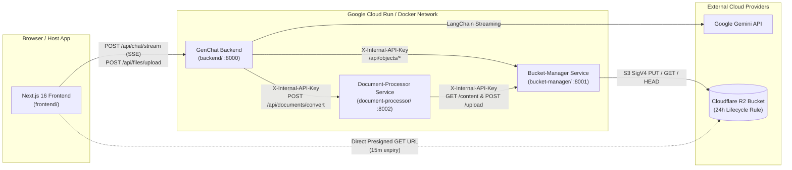

# GenChat

[](https://fastapi.tiangolo.com)
[](https://nextjs.org)
[](https://www.python.org)
[](https://www.typescriptlang.org)
[](https://developers.cloudflare.com/r2/)
[](https://pylint.org)

GenChat is a cloud-native AI agent monorepo built with **Strict Clean Architecture** Python/FastAPI microservices (`backend/`, `bucket-manager/`, and `document-processor/`) and a feature-sliced Next.js 16 (App Router) frontend (`frontend/`). It provides real-time Server-Sent Events (SSE) token and activity streaming, bounded multi-turn tool execution, isolated document conversion (`DOCX` ↔ `PDF`), and cloud object storage backed by **Cloudflare R2** with short-lived presigned URLs and 24-hour automatic file retention.

- **Backend Engineering Guide:** [`backend/README.md`](backend/README.md)
- **Bucket-Manager Service Guide:** [`bucket-manager/README.md`](bucket-manager/README.md)
- **Document-Processor Service Guide:** [`document-processor/README.md`](document-processor/README.md)
- **Engineering Standards & Architecture Rules:** [`AGENTS.md`](AGENTS.md)

---

## Repository Structure

```text
genchat/
├── backend/                       # FastAPI Clean Architecture AI Agent & API gateway service (:8000)
│   ├── app/
│   │   ├── domain/                # Entities, value objects, stream events, domain errors
│   │   ├── application/           # Use cases, outbound ports (ABC), prompt templates
│   │   ├── infrastructure/        # LangChain/Gemini adapter, tool executor, HTTP adapters for bucket-manager & document-processor
│   │   ├── presentation/          # FastAPI routers, transport schemas (DTOs), composition root
│   │   ├── config.py              # Environment settings (Pydantic Settings)
│   │   └── main.py                # ASGI entrypoint, CORS, global exception handling
│   ├── tests/                     # Unit and API integration tests
│   ├── Dockerfile
│   ├── requirements.txt
│   └── README.md                  # Backend developer & architecture guide
├── bucket-manager/                # Standalone Cloudflare R2 object storage microservice (:8001)
│   ├── app/
│   │   ├── domain/                # StoredObject, PresignedDownload, ObjectContent, UUID key generation
│   │   ├── application/           # ObjectStoragePort (ABC) & upload/presign/download/delete use cases
│   │   ├── infrastructure/        # R2StorageAdapter (S3 SigV4 REST client + 24h expiry metadata)
│   │   ├── presentation/          # Internal REST endpoints (/api/objects/*) & X-Internal-API-Key auth
│   │   ├── config.py              # R2 & retention settings
│   │   └── main.py                # ASGI entrypoint
│   ├── tests/                     # Unit and API integration tests
│   ├── Dockerfile
│   ├── requirements.txt
│   └── README.md                  # Bucket-manager architecture & R2 setup guide
├── document-processor/            # Standalone document conversion microservice (:8002)
│   ├── app/
│   │   ├── domain/                # ConvertedDocument, TargetFormat, UUID prefix stripping
│   │   ├── application/           # DocumentConverterPort (ABC) & ConvertDocumentUseCase
│   │   ├── infrastructure/        # DocumentConverterAdapter (LibreOffice / pdf2docx + bucket-manager HTTP)
│   │   ├── presentation/          # Internal REST endpoint (POST /api/documents/convert) & X-Internal-API-Key auth
│   │   ├── config.py              # Internal service settings
│   │   └── main.py                # ASGI entrypoint
│   ├── tests/                     # Unit and API integration tests
│   ├── Dockerfile
│   ├── requirements.txt
│   └── README.md                  # Document-processor architecture guide
├── frontend/                      # Next.js 16 (App Router), TypeScript, Tailwind CSS, Zustand
│   ├── src/
│   │   ├── app/                   # Root layout and application route shell
│   │   ├── features/chat/         # Chat UI components, hooks, Zustand store, API service
│   │   └── shared/                # Shared SSE/HTTP API client, UI primitives, and utilities
│   └── package.json
├── docker-compose.yml             # Local multi-container orchestration (backend + bucket-manager + document-processor)
├── AGENTS.md                      # Non-negotiable engineering & architectural rules
└── .pylintrc                      # Root linter configuration
```

---

## System Architecture



### 1. Backend (`backend/`)
Lightweight AI agent orchestrator and public API gateway (`Presentation` → `Application` → `Domain` ← `Infrastructure`):
- **Domain (`app/domain/`):** Zero external framework or transport dependencies. Defines frozen dataclasses (`ChatMessage`, `StoredFile`, `FileDownload`), discriminated union stream events (`AgentStreamEvent`), tool envelopes (`AgentToolResult[T]`), and the `DomainError` hierarchy.
- **Application (`app/application/`):** Orchestrates conversation history sanitization/truncation, prompt formatting, and file upload/download use cases via abstract ports (`ChatModelPort`, `FileStoragePort`, `DocumentProcessorPort`).
- **Infrastructure (`app/infrastructure/`):** Concrete port implementations (`LangChainChatAdapter`, `BucketManagerStorageAdapter`, `DocumentProcessorHttpAdapter`, `ToolExecutor`).
- **Presentation (`app/presentation/`):** FastAPI routers (`/api/chat/stream`, `/api/files`), Pydantic transport DTOs, SSE frame serialization, per-IP sliding-window rate limiting (`rate_limit.py`, `429` + `Retry-After`; defaults 20 chat / 10 upload / 30 download requests per minute, configurable via `*_RATE_LIMIT_PER_MINUTE`), and the Composition Root (`dependencies.py`).
- **Upload policy:** Only `.pdf` and `.docx` files up to 10 MB are accepted (enforced in the frontend, `backend/`, and `bucket-manager/`).

### 2. Bucket-Manager (`bucket-manager/`)
Dedicated internal microservice isolating Cloudflare R2 credentials (`R2_ACCESS_KEY_ID`, `R2_SECRET_ACCESS_KEY`) from the LLM/agent runtime:
- Authenticates internal service requests via `X-Internal-API-Key` using constant-time comparison (`secrets.compare_digest`).
- Generates collision-free, non-guessable UUID-prefixed object keys (`{uuid12}_{clean_filename}`).
- Signs short-lived **Cloudflare R2 Presigned GET URLs** (15-minute default expiry) and attaches 24-hour retention metadata (`FILE_RETENTION_HOURS=24`).

### 3. Document-Processor (`document-processor/`)
Dedicated internal microservice isolating heavy document conversion dependencies (LibreOffice, `docx2pdf`, `pdf2docx`) from the API server:
- Authenticates requests from `backend/` via `X-Internal-API-Key`.
- Fetches source bytes from `bucket-manager`, converts inside a temporary working directory, strips the source UUID prefix so converted filenames remain clean, and uploads the converted file back to `bucket-manager`.

### 4. Frontend (`frontend/`)
- **State Management:** Zustand store (`features/chat/store/chat.store.ts`) tracking messages, uploaded file keys, active tool executions, and thought-duration timers.
- **SSE Client:** Custom `ReadableStream` chunk parser (`shared/api/stream.ts`) handling incremental token and activity events over `POST /api/chat/stream`.
- **24-Hour Retention Notice:** Clearly informs users in the attachment tray and input footer that uploaded and converted files are automatically removed after 24 hours.

---

## Local Development

### 1. Configure Environment Variables

```bash
cp bucket-manager/.env.example bucket-manager/.env
cp document-processor/.env.example document-processor/.env
cp backend/.env.example backend/.env
```

- Set a shared `INTERNAL_API_KEY` across all three `.env` files.
- Configure Cloudflare R2 credentials in `bucket-manager/.env`.
- Configure `GEMINI_API_KEY` and `GEMINI_MODEL` in `backend/.env`.

### 2. Start All Backend Microservices

```bash
docker compose up --build
```

- **Backend API:** `http://localhost:8000` (`GET /health`, `GET /docs`)
- **Bucket-Manager API (Internal):** `http://localhost:8001` (`GET /health`)
- **Document-Processor API (Internal):** `http://localhost:8002` (`GET /health`)

### 3. Start the Frontend

```bash
cd frontend
npm install
npm run dev
```

Application UI is served at `http://localhost:3000`.

---

## Verification & Quality Gates

All changes must pass static analysis, type checking, and automated test suites before merge:

```bash
# 1. Unit & API integration tests across all 3 microservices
PYTHONPATH=bucket-manager backend/.venv/bin/python -m pytest bucket-manager/tests -v
PYTHONPATH=document-processor backend/.venv/bin/python -m pytest document-processor/tests -v
PYTHONPATH=backend backend/.venv/bin/python -m pytest backend/tests -v

# 2. Pylint static analysis (all 3 services must score 10.00/10)
backend/.venv/bin/python -m pylint backend/app backend/tests
backend/.venv/bin/python -m pylint --rcfile=bucket-manager/.pylintrc bucket-manager/app bucket-manager/tests
backend/.venv/bin/python -m pylint --rcfile=document-processor/.pylintrc document-processor/app document-processor/tests

# 3. Frontend TypeScript & ESLint checks
./frontend/node_modules/.bin/tsc -p frontend/tsconfig.json --noEmit
cd frontend && npm run lint
```

---

## License

MIT License — Paul Corsino.
