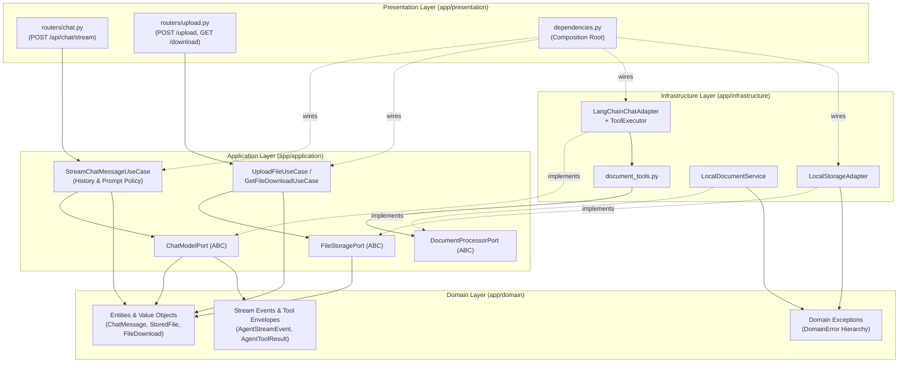

# GenChat

[](https://fastapi.tiangolo.com)
[](https://nextjs.org)
[](https://www.python.org)
[](https://www.typescriptlang.org)
[](https://pylint.org)

GenChat is a full-stack AI agent monorepo built with a **Strict Clean Architecture** Python/FastAPI backend and a feature-sliced Next.js 16 (App Router) frontend. It provides real-time Server-Sent Events (SSE) token and activity streaming, bounded multi-turn tool execution, and streaming file operations.

- **Backend Engineering Guide:** [`backend/README.md`](backend/README.md)
- **Engineering Standards & Architecture Rules:** [`AGENTS.md`](AGENTS.md)

---

## Repository Structure

```text
genchat/
├── backend/                       # FastAPI Clean Architecture modular monolith
│   ├── app/
│   │   ├── domain/                # Entities, value objects, stream events, domain errors
│   │   ├── application/           # Use cases, outbound ports (ABC), prompt templates
│   │   ├── infrastructure/        # LangChain/Gemini adapter, tool executor, storage, document service
│   │   ├── presentation/          # FastAPI routers, transport schemas (DTOs), composition root
│   │   ├── config.py              # Environment settings (Pydantic Settings)
│   │   └── main.py                # ASGI entrypoint, CORS, global exception handling
│   ├── tests/                     # Unit and API integration tests
│   ├── Dockerfile
│   ├── requirements.txt
│   └── README.md                  # Backend developer & architecture guide
├── frontend/                      # Next.js 16 (App Router), TypeScript, Tailwind CSS, Zustand
│   ├── src/
│   │   ├── app/                   # Root layout and application route shell
│   │   ├── features/chat/         # Chat UI components, hooks, Zustand store, API service
│   │   └── shared/                # Shared SSE/HTTP API client, UI primitives, and utilities
│   └── package.json
├── docker-compose.yml             # Local container orchestration
├── AGENTS.md                      # Non-negotiable engineering & architectural rules
└── .pylintrc                      # Root linter configuration
```

---

## Architecture Overview

### Backend (`backend/`)

The backend enforces strict inward dependency direction (`Presentation` → `Application` → `Domain` ← `Infrastructure`):



1. **Domain (`app/domain/`):** Zero external framework or transport dependencies. Defines frozen dataclasses for entities and value objects (`ChatMessage`, `StoredFile`, `FileDownload`), discriminated union stream events (`AgentStreamEvent`), tool envelopes (`AgentToolResult[T]`), and the `DomainError` exception hierarchy.
2. **Application (`app/application/`):** Orchestrates business rules, conversation history sanitization/truncation, and prompt construction. Declares abstract ports (`ChatModelPort`, `FileStoragePort`, `DocumentProcessorPort`) typed exclusively with domain models.
3. **Infrastructure (`app/infrastructure/`):** Concrete port implementations (`LangChainChatAdapter`, `LocalStorageAdapter`, `LocalDocumentService`, `ToolExecutor`). Translates vendor/OS exceptions into `DomainError` subclasses at the port boundary.
4. **Presentation (`app/presentation/`):** FastAPI routers (`/api/chat/stream`, `/api/files`), Pydantic transport DTOs, SSE frame serialization, and the Composition Root (`dependencies.py`).

See [`backend/README.md`](backend/README.md) for detailed architecture and sequence diagrams, plus guidelines on adding use cases, ports, typed value objects, and cohesive helper functions.

### Frontend (`frontend/`)

- **State Management:** Zustand store (`features/chat/store/chat.store.ts`) tracking messages, attachments, active tool executions, and thought-duration timers.
- **SSE Client:** Custom `ReadableStream` chunk parser (`shared/api/stream.ts`) handling incremental token and activity events over `POST /api/chat/stream`.

---

## SSE Event Protocol (`POST /api/chat/stream`)

Events are streamed as `data: <JSON>\n\n` frames discriminated by `"type"`:

| `type` | Payload | Description |
| :--- | :--- | :--- |
| `activity` | `{"type": "activity", "id": string, "message": string, "status": "started" \| "completed"}` | Execution timeline milestone (`AgentExecutionTimeline`) |
| `token` | `{"type": "token", "token": string}` | Incremental assistant text token |
| `error` | `{"type": "error", "error": string}` | Terminal stream error message |
| `complete` | `{"type": "complete"}` | Generation completed |

---

## Local Development

### Prerequisites

- Docker & Docker Compose (or Python 3.11+ for local virtual environment execution)
- Node.js 18+
- Google Gemini API key

### 1. Start the Backend

```bash
cp backend/.env.example backend/.env
```

Set `GEMINI_API_KEY`, `GEMINI_MODEL`, and `FRONTEND_ORIGIN` in `backend/.env`, then run via Docker Compose:

```bash
docker compose up --build
```

Or run directly in a Python virtual environment:

```bash
cd backend
python3 -m venv .venv
source .venv/bin/activate
pip install -r requirements.txt
uvicorn app.main:app --port 8000 --reload
```

- **API Base URL:** `http://localhost:8000`
- **Health Check:** `GET http://localhost:8000/health`
- **OpenAPI Docs:** `http://localhost:8000/docs`

### 2. Start the Frontend

```bash
cd frontend
npm install
npm run dev
```

Application UI is served at `http://localhost:3000`.

---

## Verification & Quality Gates

All changes must pass static analysis, type checking, and automated test suites before merge:

```bash
# Backend unit & API integration tests
python -m pytest backend/tests -v

# Backend static analysis (must score 10.00/10)
python -m pylint backend/app backend/tests

# Frontend TypeScript check
cd frontend && npx tsc --noEmit
```

---

## License

MIT License — Paul Corsino.
