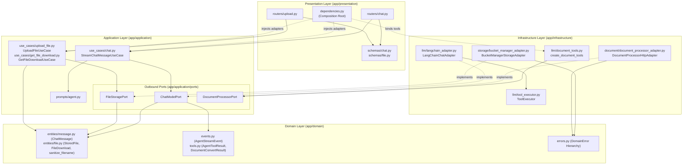
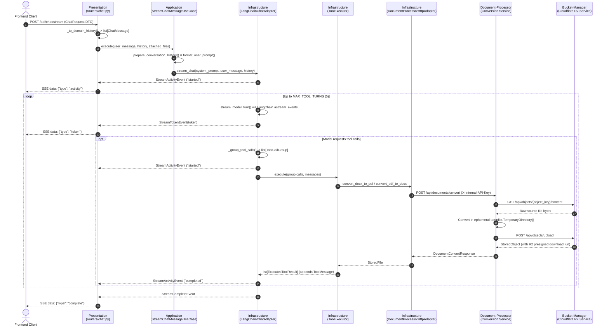

# GenChat Backend — Architecture & Developer Guide

This document defines the architectural patterns, typing conventions, and step-by-step workflows for extending the GenChat backend (`backend/app/`).

---

## 1. Clean Architecture Layer Boundaries

Dependencies point strictly inward (`Presentation` → `Application` → `Domain` ← `Infrastructure`):



### Runtime Request, SSE Streaming & Document Conversion Flow



### Layer Rules

| Layer | Directory | Allowed Imports | Forbidden Imports / Concerns |
| :--- | :--- | :--- | :--- |
| **Domain** | `app/domain/` | Python standard library (`dataclasses`, `typing`), `pydantic` (for discriminated stream events and tool result envelopes) | `fastapi`, `langchain`, `os.path`, HTTP status codes, URL paths, database drivers |
| **Application** | `app/application/` | `app.domain.*`, Python standard library (`abc`, `collections.abc`, `typing`) | `app.infrastructure.*`, `app.presentation.*`, `os.path`, HTTP routes (`/api/...`), vendor SDKs |
| **Infrastructure** | `app/infrastructure/` | `app.domain.*`, `app.application.ports.*`, third-party SDKs (`langchain_core`, `httpx`, `tempfile`, `os`, `importlib`) | `app.presentation.*`, `fastapi.HTTPException` |
| **Presentation** | `app/presentation/` | `app.domain.*`, `app.application.*`, `app.infrastructure.*` (in `dependencies.py` only), `fastapi`, `pydantic` | Embedding business rules or direct SDK calls inside route handlers |

---

## 2. Typing Standards: Classes Over Raw Primitive Tuples

### Why We Avoid Raw Positional Tuples (`tuple[str, str, int, ...]`)

Returning raw tuples like `tuple[str, str, int, str, str]` or `tuple[str, str]` across functions, ports, or use cases is a **Primitive Obsession** code smell:

1. **Positional Fragility:** Callers unpack by position (`a, b, c = fn()`). Swapping two `str` values (e.g., `filename` and `download_url`) silently introduces bugs that static type checkers cannot catch because both are `str`.
2. **Zero Self-Documentation:** A signature like `-> tuple[str, str, str]` forces engineers to read the function body or docstring to know which element is the input path, output path, or filename.
3. **Hard to Extend:** Adding a field breaks every unpacking call site across the codebase and test suite.

### What to Use Instead

Use **named, structured classes** according to the layer's responsibility:

| Use Case | Recommended Construct | Example in Codebase |
| :--- | :--- | :--- |
| **Domain Entities, Value Objects & Port Returns** | `@dataclass(frozen=True)` | `ChatMessage`, `StoredFile`, `FileDownload` (`app/domain/entities/`) |
| **Internal Adapter / Helper Return Values & Cache Keys** | `@dataclass(frozen=True)` | `ConversionPaths` (`document_service.py`), `ToolCacheKey`, `ExecutedToolResult` (`tool_executor.py`), `ToolCallGroup` (`langchain_adapter.py`) |
| **Mutable Internal Stream Accumulators** | `@dataclass` | `_TurnStreamCollector`, `AgentChatContext` (`langchain_adapter.py`) |
| **Serialized Stream Events & Tool Envelopes** | `pydantic.BaseModel` | `StreamActivityEvent`, `StreamTokenEvent`, `AgentToolResult[T]` (`app/domain/events.py`, `tools.py`) |
| **HTTP Request / Response Payloads (DTOs)** | `pydantic.BaseModel` | `ChatRequest`, `FileUploadResponse` (`app/presentation/schemas/`) |

#### Bad vs. Good Example

```python
# BAD: Positional primitive tuple return
def save_file(self, filename: str, file_obj: BinaryIO) -> tuple[str, str, int]:
    ...
    return object_key, download_url, size_bytes

# GOOD: Immutable Domain Value Object
@dataclass(frozen=True)
class StoredFile:
    filename: str
    original_name: str
    size_bytes: int
    download_url: str

def save_file(self, filename: str, file_obj: BinaryIO) -> StoredFile:
    ...
    return StoredFile(
        filename=data["object_key"],
        original_name=data["original_name"],
        size_bytes=data["size_bytes"],
        download_url=data["download_url"],
    )
```

---

## 3. Eliminating False Optionals

Never declare parameters or fields as `T | None = None` unless `None` represents a distinct, valid domain state:

- **Collections:** Use `Sequence[T] = ()` for input parameters that may be empty (e.g., `history: Sequence[ChatMessage] = ()`, `attached_files: Sequence[str] = ()`). Do not use `list[T] | None = None`.
- **Required Fields:** If every caller or event producer supplies a value (e.g., `StreamActivityEvent.message`), type it as `str`, not `str | None = None`.
- **Legitimate Optionals:** Use `T | None` only when absence has explicit domain semantics (e.g., `AgentToolResult.data: T | None = None` when `success=False`, or `_TurnStreamCollector.ai_message: AIMessage | None = None` before the stream finishes).

---

## 4. Writing Cohesive, Reusable Functions & Reducing Scope

Keep functions short, single-purpose, and free of Pylint complexity suppressions (`too-many-locals`, `too-many-branches`):

1. **Extract Pure Application Policy Helpers:**
   Place stateless data-preparation functions (such as `prepare_conversation_history` and `format_user_prompt` in `app/application/use_cases/chat.py`) at the module level in the Application layer so they can be unit-tested directly without mocking adapters.
2. **Decompose Multi-Step Adapter Loops:**
   When an infrastructure method handles multiple concerns (e.g., streaming chunks, grouping tool calls, executing tools, and emitting lifecycle events in `LangChainChatAdapter`), decompose each responsibility into a focused helper method:
   - `_stream_model_turn(...)` — single-turn token streaming
   - `_group_tool_calls(...)` — grouping raw `ToolCall` dicts into `list[ToolCallGroup]`
   - `_execute_tool_group_stream(...)` — running a single tool group and yielding start/end events
   - `_run_streaming_turns(...)` — bounded `MAX_TOOL_TURNS` loop orchestration
3. **Deduplicate Shared Boilerplate:**
   - In `document_tools.py`, `_execute_conversion(...)` encapsulates the `try/except`, logging, and `AgentToolResult[DocumentConvertResult]` wrapping so each `@tool` definition is a single declarative call.
   - In `document_service.py`, `_stage_conversion_paths(...)` centralizes input byte fetching, ephemeral staging in `tempfile.TemporaryDirectory()`, and output path construction into a typed `ConversionPaths` dataclass.

---

## 5. How to Add a New Use Case (End-to-End Recipe)

Follow these 6 steps whenever adding a new feature or capability to the backend:

### Step 1: Define Domain Models & Errors (`app/domain/`)
Create immutable entities/value objects in `app/domain/entities/` and specific domain exceptions in `app/domain/errors.py`.

```python
# app/domain/entities/summary.py
from dataclasses import dataclass

@dataclass(frozen=True)
class ExtractedDocument:
    filename: str
    text: str
    word_count: int
```

### Step 2: Declare or Extend an Outbound Port (`app/application/ports/`)
Define the abstract contract the Application layer needs from Infrastructure using domain types only.

```python
# app/application/ports/document_processor_port.py
class DocumentProcessorPort(ABC):
    @abstractmethod
    def extract_text(self, filename: str) -> str:
        """Extract plain text from a stored document. Raises FileNotFoundDomainError."""
```

### Step 3: Implement the Application Use Case (`app/application/use_cases/`)
Inject the abstract port(s) via `__init__`, validate domain preconditions, and return the domain value object.

```python
# app/application/use_cases/extract.py
from app.domain.entities.summary import ExtractedDocument
from app.domain.errors import InvalidFileError
from app.application.ports.document_processor_port import DocumentProcessorPort

class ExtractDocumentTextUseCase:
    def __init__(self, processor: DocumentProcessorPort):
        self._processor = processor

    def execute(self, filename: str) -> ExtractedDocument:
        clean_name = filename.strip()
        if not clean_name:
            raise InvalidFileError("Filename cannot be empty.")

        raw_text = self._processor.extract_text(clean_name)
        return ExtractedDocument(
            filename=clean_name,
            text=raw_text,
            word_count=len(raw_text.split()),
        )
```

### Step 4: Implement the Port in Infrastructure (`app/infrastructure/`)
Implement the concrete logic in the appropriate adapter and translate any low-level/OS exceptions into `DomainError` subclasses.

### Step 5: Wire Dependencies in the Composition Root (`app/presentation/dependencies.py`)
Instantiate and wire the concrete adapter into the use case factory function.

```python
def get_extract_text_use_case() -> ExtractDocumentTextUseCase:
    return ExtractDocumentTextUseCase(processor=_document_service)
```

### Step 6: Expose the Route & Transport DTOs (`app/presentation/`)
Create Pydantic request/response schemas in `app/presentation/schemas/`, call the use case via `Depends(...)` in `app/presentation/routers/`, and map `DomainError` subclasses to HTTP status codes (`400`, `404`, `413`, `500`).

---

## 6. Abuse Protection: Rate Limits, Payload Bounds & File Types

Implemented in the Presentation layer (`app/presentation/rate_limit.py`, wired as route dependencies in `app/presentation/dependencies.py`):

| Endpoint | Setting | Default (per client IP / minute) |
|---|---|---|
| `POST /api/chat/stream` | `CHAT_RATE_LIMIT_PER_MINUTE` | `20` |
| `POST /api/files/upload` | `UPLOAD_RATE_LIMIT_PER_MINUTE` | `10` |
| `GET /api/files/download/{filename}` | `DOWNLOAD_RATE_LIMIT_PER_MINUTE` | `30` |

- `SlidingWindowRateLimiter` is a thread-safe, in-memory sliding window keyed by client IP (first `X-Forwarded-For` hop, falling back to the socket peer). Exceeding the quota returns `429 Too Many Requests` with a `Retry-After` header.
- Counters are per process. With multiple Cloud Run instances each instance enforces its own limit; use a shared store if strict global limits are required.
- `ChatRequest` bounds: `message` ≤ 8000 chars, `history` ≤ 20 entries, `attached_files` ≤ 5 (violations return `422`).
- Only `.pdf` and `.docx` uploads are accepted (`ALLOWED_FILE_EXTENSIONS` in `app/domain/entities/file.py`); other extensions return `400`. Uploads above 10 MB return `413`.

## 7. Testing & Linting Checklist

Before submitting any backend change, run both commands from the repository root:

```bash
# 1. Run unit and integration tests
PYTHONPATH=backend backend/.venv/bin/python -m pytest backend/tests -v

# 2. Run Pylint (must score 10.00/10 with zero complexity suppressions)
backend/.venv/bin/python -m pylint backend/app backend/tests
```
