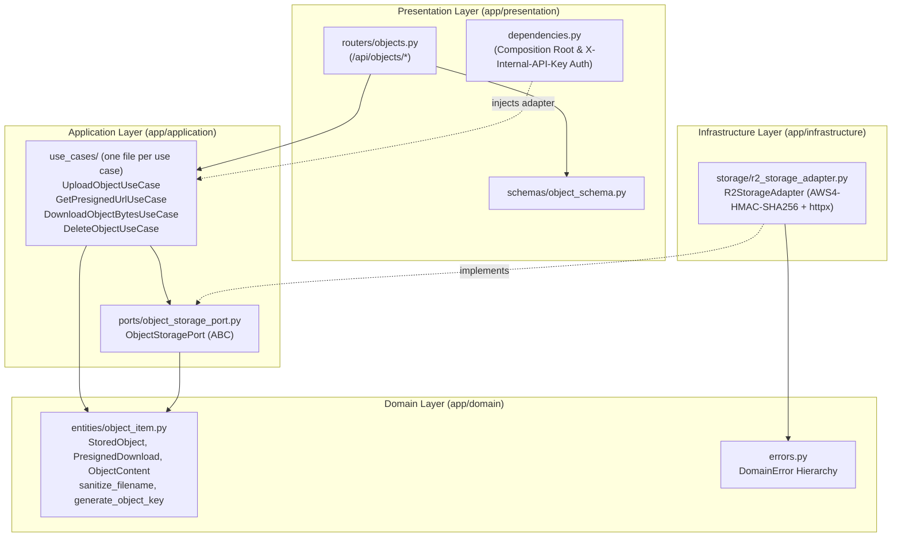

# GenChat Bucket-Manager — Cloud Object Storage Microservice

`bucket-manager` is a standalone, stateless **Strict Clean Architecture** Python/FastAPI microservice that manages object uploads, presigned download URLs, raw byte retrieval, and deletions in **Cloudflare R2** (S3-compatible API).

It is designed for private service-to-service communication with `backend/` on **Google Cloud Run** or Docker Compose, isolating Cloudflare R2 credentials (`R2_ACCESS_KEY_ID`, `R2_SECRET_ACCESS_KEY`) from the LLM/agent execution environment.

---

## 1. Architecture Overview

Dependencies point strictly inward (`Presentation` → `Application` → `Domain` ← `Infrastructure`):



---

## 2. Security & File Lifecycle Policy

1. **Service-to-Service Authentication (`X-Internal-API-Key`):**
   - Every `/api/objects/*` endpoint requires the `X-Internal-API-Key` HTTP header.
   - `verify_internal_api_key` in `app/presentation/dependencies.py` verifies the header using `secrets.compare_digest` to prevent timing attacks.
   - On Google Cloud Run, deploy `bucket-manager` with `--no-allow-unauthenticated` (internal ingress) in addition to `X-Internal-API-Key`.
   - Cloud Run IAM rejects callers without a Google-signed ID token (`403 ... Empty Authorization header value`) before the app runs. Callers (`backend`, `document-processor`) therefore set `INTERNAL_IAM_AUTH_ENABLED=true` and send `Authorization: Bearer <ID token>` (audience = this service's URL) alongside `X-Internal-API-Key`. Grant each caller's runtime service account the invoker role:
     ```bash
     gcloud run services add-iam-policy-binding general-chat-bucket-manager \
       --region=<REGION> \
       --member="serviceAccount:<CALLER_SA>@<PROJECT>.iam.gserviceaccount.com" \
       --role="roles/run.invoker"
     ```
2. **Non-Guessable Object Keys (IDOR & Collision Prevention):**
   - Uploaded filenames are sanitized via `sanitize_filename()` and prefixed with a 12-character UUID hex (`generate_object_key()` -> `{uuid12}_{clean_filename}`).
   - Only `.pdf` and `.docx` extensions are accepted (`ALLOWED_OBJECT_EXTENSIONS`); others return HTTP `400`.
3. **10 MB Streaming Upload Guard (`MAX_UPLOAD_SIZE_BYTES`):**
   - `read_bounded_stream()` in `app/application/use_cases/upload_object.py` reads incoming uploads in 64 KB chunks and immediately aborts with HTTP `413 Content Too Large` if the stream exceeds `10,485,760` bytes.
4. **Short-Lived Presigned Download URLs:**
   - Downloads use S3 Signature Version 4 (`AWS4-HMAC-SHA256`) presigned GET URLs (`PRESIGNED_URL_EXPIRY_SECONDS=900` / 15 minutes by default) with `response-content-disposition=attachment`.
5. **24-Hour Auto-Deletion (`FILE_RETENTION_HOURS=24`):**
   - Every uploaded object records `x-amz-meta-expires-at` metadata (`now + 24h`) and returns `expires_at` in `ObjectUploadResponse`.
   - Configure a matching **Object Lifecycle Rule** on your Cloudflare R2 bucket (Cloudflare Dashboard → R2 → Bucket → Settings → Object lifecycle rules → **Delete uploaded objects after 1 day / 24 hours**) so R2 automatically purges expired files at zero cost.
   - Note: See the `# TODO` comment in `R2StorageAdapter.put_object` (`app/infrastructure/storage/r2_storage_adapter.py`) if permanent retention is required in the future.

---

## 3. API Endpoints

All `/api/objects/*` endpoints require `X-Internal-API-Key: <INTERNAL_API_KEY>`.

| Method | Path | Description | Responses |
| :--- | :--- | :--- | :--- |
| `GET` | `/health` | Liveness/readiness probe | `200 OK` |
| `POST` | `/api/objects/upload` | Multipart file upload to R2 | `200 OK` (`ObjectUploadResponse`), `400`, `401`, `413`, `502` |
| `GET` | `/api/objects/{object_key}/presigned` | Generate a fresh presigned R2 GET URL | `200 OK` (`PresignedUrlResponse`), `401`, `404`, `502` |
| `GET` | `/api/objects/{object_key}/content` | Fetch raw object bytes for backend document conversion | `200 OK` (`application/octet-stream`), `401`, `404`, `502` |
| `DELETE` | `/api/objects/{object_key}` | Delete an object from R2 | `200 OK` (`DeleteObjectResponse`), `401`, `404`, `502` |

---

## 4. Environment Configuration (`.env`)

Copy `.env.example` to `.env`:

```bash
cp .env.example .env
```

| Variable | Required | Default | Description |
| :--- | :--- | :--- | :--- |
| `INTERNAL_API_KEY` | Yes | — | Shared secret matching `INTERNAL_API_KEY` in `backend/` |
| `R2_ENDPOINT_URL` | Yes | — | `https://<ACCOUNT_ID>.r2.cloudflarestorage.com` |
| `R2_ACCESS_KEY_ID` | Yes | — | Cloudflare R2 S3 API Access Key ID |
| `R2_SECRET_ACCESS_KEY` | Yes | — | Cloudflare R2 S3 API Secret Access Key |
| `R2_BUCKET_NAME` | Yes | — | Target R2 bucket name (e.g., `genchat-files`) |
| `PRESIGNED_URL_EXPIRY_SECONDS` | No | `900` | Presigned download URL lifetime in seconds (15 min) |
| `FILE_RETENTION_HOURS` | No | `24` | Retention metadata window in hours (24h) |
| `PORT` | No | `8001` | HTTP listen port |

---

## 5. Testing & Static Analysis

Run from the repository root:

```bash
# Run unit and FastAPI integration tests
PYTHONPATH=bucket-manager backend/.venv/bin/python -m pytest bucket-manager/tests -v

# Run Pylint (must score 10.00/10)
backend/.venv/bin/python -m pylint --rcfile=bucket-manager/.pylintrc bucket-manager/app bucket-manager/tests
```
