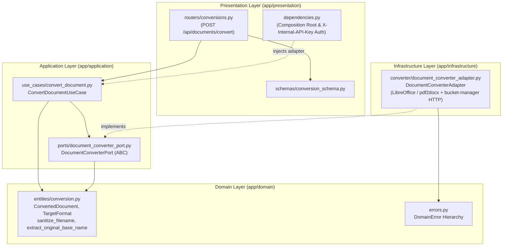

# GenChat Document-Processor — Document Conversion Microservice

`document-processor` is a standalone, stateless **Strict Clean Architecture** Python/FastAPI microservice that performs document format conversions (`DOCX` ↔ `PDF`).

By isolating CPU- and memory-intensive conversion engines (headless LibreOffice, `docx2pdf`, `pdf2docx`) into a dedicated microservice, `backend/` remains lightweight and responsive for SSE chat streaming while `document-processor` can be scaled independently on **Google Cloud Run**.

---

## 1. Architecture Overview

Dependencies point strictly inward (`Presentation` → `Application` → `Domain` ← `Infrastructure`):



---

## 2. Conversion Lifecycle & Ephemeral Execution

1. **Internal Request Authentication (`X-Internal-API-Key`):**
   - `POST /api/documents/convert` requires the `X-Internal-API-Key` header verified with `secrets.compare_digest`.
2. **Fetch Source Bytes from `bucket-manager`:**
   - `DocumentConverterAdapter` calls `GET {BUCKET_MANAGER_URL}/api/objects/{filename}/content` with `X-Internal-API-Key`.
3. **Temporary Staging & UUID Prefix Stripping:**
   - Source bytes are staged inside `tempfile.TemporaryDirectory()`.
   - `extract_original_base_name()` strips the 12-hex UUID prefix from the input key (e.g., `a1b2c3d4e5f6_report.docx` → `report.pdf`) so the converted file does not accumulate nested UUID prefixes.
4. **Format Conversion:**
   - `target_format == "pdf"`: Converts `DOCX` → `PDF` via headless LibreOffice (`libreoffice --headless --convert-to pdf`) or `docx2pdf`.
   - `target_format == "docx"`: Converts `PDF` → `DOCX` via `pdf2docx`.
5. **Upload Converted Artifact to `bucket-manager`:**
   - Uploads the converted file via `POST {BUCKET_MANAGER_URL}/api/objects/upload` and returns the new `converted_filename` object key and R2 presigned `download_url`.
   - The temporary directory is automatically wiped upon exit.

---

## 3. API Endpoints

| Method | Path | Description | Responses |
| :--- | :--- | :--- | :--- |
| `GET` | `/health` | Liveness/readiness probe | `200 OK` |
| `POST` | `/api/documents/convert` | Convert a stored file to `pdf` or `docx` | `200 OK` (`DocumentConvertResponse`), `400`, `401`, `404`, `422`, `502` |

---

## 4. Environment Configuration (`.env`)

Copy `.env.example` to `.env`:

```bash
cp .env.example .env
```

| Variable | Required | Default | Description |
| :--- | :--- | :--- | :--- |
| `INTERNAL_API_KEY` | Yes | — | Shared secret matching `backend/` and `bucket-manager/` |
| `BUCKET_MANAGER_URL` | Yes | — | Internal URL of `bucket-manager` (e.g., `http://bucket-manager:8001`) |

---

## 5. Testing & Static Analysis

Run from the repository root:

```bash
# Run unit and FastAPI integration tests
PYTHONPATH=document-processor backend/.venv/bin/python -m pytest document-processor/tests -v

# Run Pylint (must score 10.00/10)
backend/.venv/bin/python -m pylint --rcfile=document-processor/.pylintrc document-processor/app document-processor/tests
```
